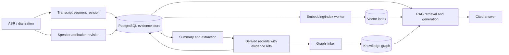
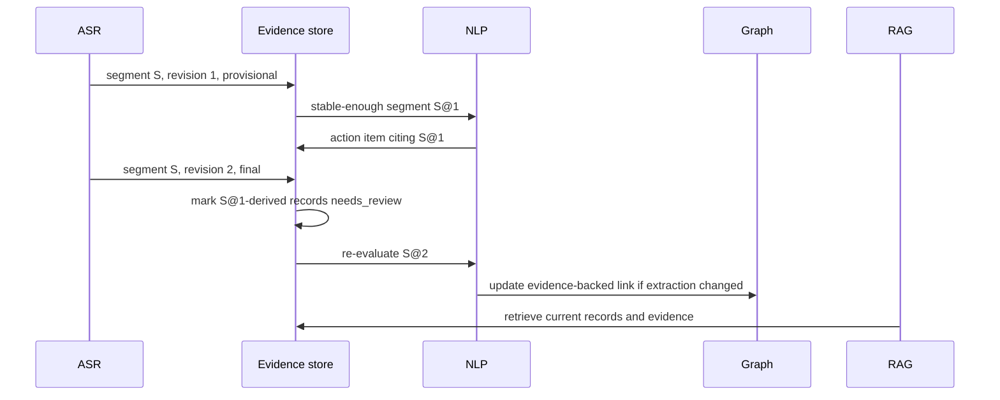

"""
Week 09 (05-10-2026 - 11-10-2026)
Task: Update architecture docs to reflect the revised design

Why this matters:
The Week 8 model changes how provisional transcript data becomes stable
evidence. Updating the architecture prevents later services from using an
outdated assumption that transcript segments or speaker labels are immutable.

What this script does:
This design note updates the component and event flow to include revisions,
speaker-attribution records, and dependent-record re-evaluation.
"""

# Week 9 — revised architecture reference

## Revised evidence flow

## Revision event flow

## Updated responsibilities

| Component | New/clarified responsibility |
| --- | --- |
| ASR/diarization | Emits revision/finality information; keeps speaker labels separate from identities |
| Storage | Maintains immutable evidence history and identifies dependent records requiring review |
| NLP | Creates provenance-bearing records and re-evaluates invalidated records |
| Graph | Links only evidence-supported records; never treats a local speaker label as global identity |
| RAG | Prefers active/current evidence and indicates incomplete/low-confidence support when appropriate |

## Unchanged architecture decisions

PostgreSQL remains the canonical evidence store, vector search remains a
derived retrieval mechanism, the graph remains lightweight and explainable,
and public clients continue to use the versioned backend API. The revised
model changes data semantics, not the chosen service topology.

## Architecture deltas from Week 8

The following changes are now part of the reference architecture rather than
optional implementation details:

| Concern | Earlier assumption | Revised architecture rule |
| --- | --- | --- |
| Transcript identity | A segment could be treated as the latest text | `(segment_id, revision)` is immutable evidence; the latest revision is a derived current view |
| Speaker identity | A speaker label could be passed downstream as an identity | `speaker_label` is session-local; person resolution is separate and reviewable |
| Derived records | A summary or action item could remain valid after source correction | Source revision changes create a `needs_review` dependency edge |
| Search indexes | An embedding could be treated as canonical content | Embeddings are replaceable projections keyed to a stored record and evidence revision |
| Citations | A record ID was sufficient for a citation | A citation includes session, segment, revision, and time range |

These deltas preserve the existing modular deployment plan while making the
evidence lifecycle explicit. A worker may be introduced later for re-indexing
or re-evaluation, but no worker is allowed to discard the immutable source
history.

## Traceability rules for implementation

1. A consumer must key idempotency and deduplication on `event_id`, while
   transcript history is keyed on `(segment_id, revision)`.
2. A consumer that stores a derived record must persist the exact evidence
   revision it used; storing only `segment_id` is insufficient.
3. Retrieval must filter out `superseded` derived records by default and must
   expose `needs_review` or incomplete evidence in the answer metadata.
4. A graph relationship may reference a local speaker label only as a
   session-scoped observation. It may reference a person node only after an
   explicit identity-resolution step.
5. Any breaking interpretation change requires a new internal
   `schema_version`; additive optional fields can remain backward compatible.

## Deployment compatibility note

The first deployment can keep storage, graph linking, indexing, and RAG in
one FastAPI process with background tasks. The event boundaries above are the
stable seam: moving any stage to a queue or separate worker must preserve the
same identifiers, revision handling, and evidence references.

## WEEK OUTPUT CONTRACT

**Input:** The Week 8 diarization-aware model and the Week 2 service contract.

**Output:** The revised architecture diagram and event sequence that all
future schema, graph, and RAG work must follow.
